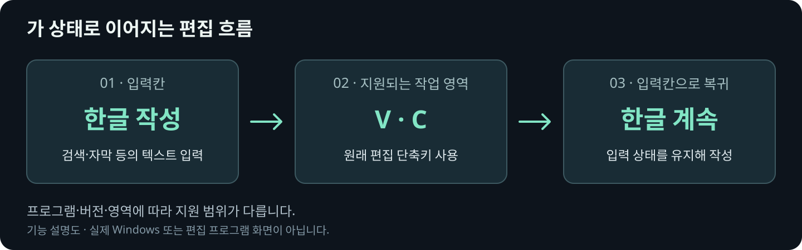

<p align="center">
  
</p>

<h1 align="center">CONTENTRIUM Keys</h1>

<p align="center">
  <strong>한글은 자연스럽게. 단축키는 익숙하게.</strong><br>
  입력칸에서는 두벌식 한글을, 지원되는 편집 영역에서는 한/영 전환 없이 원래 단축키를 사용하세요.
</p>

<p align="center">
  <a href="https://github.com/contentriumkorea/rium-keys/releases/latest"></a>
  <a href="#적용-범위와-제한"></a>
  <a href="LICENSE"></a>
</p>

<p align="center">
  <a href="#빠르게-시작하기">설치하기</a> ·
  <a href="https://github.com/contentriumkorea/rium-keys/releases/latest/download/CONTENTRIUM-Keys-Setup.exe">다운로드</a> ·
  <a href="#사용-모습">사용 모습</a> ·
  <a href="docs/installation.md">상세 안내</a>
</p>

---

<a id="설치하기"></a>

## 빠르게 시작하기

**Windows x64 · 한국어와 Microsoft 입력기 필요.** 새 설치 전 현재·기본 입력기로 한국어 Microsoft 입력기를 선택하고, 복구를 위해 삭제하지 마세요.

[](https://github.com/contentriumkorea/rium-keys/releases/latest/download/CONTENTRIUM-Keys-Setup.exe)

1. 작업을 저장하고 편집 프로그램을 종료한 뒤, 설치 파일을 **일반 실행**합니다.
2. 등록 단계의 Windows 관리자 확인창에서 **예**를 누르고 자동 점검 후 마칩니다. 직접 타이핑하는 시험은 없으며 재시작 시점은 선택할 수 있습니다.
3. **Windows + Space → CONTENTRIUM Keys**를 선택합니다.

설치 파일은 **약 661KB**입니다. [SHA-256 확인](https://github.com/contentriumkorea/rium-keys/releases/latest/download/SHA256SUMS.txt) · [상세 설치 및 업데이트 안내 →](docs/installation.md)

## 한글과 단축키 사이, 전환을 줄이세요

| 01 · 한글 입력 | 02 · 편집 단축키 | 03 · Windows 입력기 |
| :--- | :--- | :--- |
| **입력칸에서는 두벌식 한글** | **익숙한 작업 키 그대로** | **별도 설정 창 없이** |
| 검색·자막 등 텍스트를 작성하는 입력칸에서 한글을 조합합니다. | 지원되는 작업 영역에서 한글 상태를 유지하며 원래 단축키를 사용합니다. | Windows 입력기 메뉴에서 한/영 전환과 입력기 사용 여부를 조절합니다. |

## 사용 모습

<p align="center">
  
</p>

**입력칸과 작업 영역을 오가며 한글 입력과 단축키를 이어갑니다.**

실제 동작을 설명한 도식이며 프로그램 화면 캡처가 아닙니다. 프로그램·버전·패널에 따라 지원 범위가 다르며, 모든 Windows 프로그램의 호환성을 보장하지 않습니다.

<details>
<summary><strong>추가 예시 보기</strong></summary>

<a id="우측-하단-표시"></a>


제품 아이콘을 정리한 설명용 배치이며 Windows 화면 캡처가 아닙니다.

| 표시 | 의미 |
| :--- | :--- |
| **CK** | CONTENTRIUM Keys 입력기 선택 로고 |
| **가** | 한글 입력 |
| **A** | 영어 입력 또는 입력기를 끈 직접 입력 |

`가 / A`를 클릭하면 한/영이 바뀝니다. 우클릭 메뉴의 **입력기 사용**으로 기능을 켜거나 끕니다. Windows가 CK와 가/A를 나란히 표시해도 프로그램이 두 개 실행된 것은 아닙니다.

</details>

<a id="업데이트와-제거"></a>

## 설치·업데이트 안내

| 방식 | 사용 방법 |
| :--- | :--- |
| **Windows 설치 파일** | 본체가 포함된 `CONTENTRIUM-Keys-Setup.exe`를 받습니다. Windows가 선택된 입력기를 불러오므로 별도 트레이 유틸리티나 자동 실행 EXE를 켜지 않습니다. |
| **기존 설치 업데이트** | 2.0.1은 같은 EXE로 업데이트할 수 있습니다. 2.0.0과 그보다 오래된 입력기는 [버전별 설치 순서](docs/installation.md#기존-버전에서-설치)를 먼저 확인하세요. |
| **온라인 설치·자동 업데이트** | 현재 공개판 2.0.3에는 포함하지 않습니다. 새 버전은 GitHub에서 설치 파일을 받아 설치합니다. |
| **포터블 ZIP** | Windows 입력기 등록이 필요하므로 제공하지 않습니다. `Source code.zip`은 설치 파일이나 포터블 앱이 아닙니다. |
| **제거·복구** | Windows 설정 → 앱 → 설치된 앱 → CONTENTRIUM Keys → 제거. 설치 전 입력기로 복구하며 개인 설정과 복구 기록은 보존합니다. |

최신 정식판만 공개하고 이전 릴리스·첨부파일은 삭제하지 않고 비공개 초안으로 보관합니다. 2.0.1·2.0.2 사용자는 같은 설치 파일로 2.0.3으로 업데이트할 수 있습니다.

## 이렇게 사용하세요

```text
Windows + Space → CONTENTRIUM Keys 선택
입력칸에서 한글 작성
지원되는 편집 영역을 선택하고 원래 단축키 사용
입력칸으로 돌아와 한글 계속 작성
```

기본 입력기를 CONTENTRIUM Keys로 유지하면 로그인 후에도 사용할 수 있습니다. 구형 RIUM Keys 유틸리티는 새 입력기로 자동 전환되지 않으므로 [설치·전환 안내](docs/installation.md)를 따르세요.

<a id="지원-범위"></a>

## 적용 범위와 제한

- **확인된 환경:** 표준 Windows 입력칸·버튼, Premiere Pro 26.5.2.5와 Studio One 6.6.4.102451의 일부 시험 경로입니다. After Effects 26.5.0.89는 실제 단축키와 입력칸 복귀를 추가 검증해야 합니다.
- **설치 조건:** Windows ARM64·32비트 운영체제는 지원 대상으로 검증하지 않았습니다. 설치 파일에는 Windows 게시자 코드 서명이 없습니다. 재시작을 미루면 기존 앱이나 작업 표시줄에 이전 입력기·아이콘이 남을 수 있습니다.
- **개인정보:** 입력·문서 내용을 서버로 전송하지 않습니다. 2.0.3 입력기 자체는 업데이트 확인 통신도 하지 않습니다. 설정·복구 기록·설치 로그는 PC에 보관합니다.

<details>
<summary><strong>상세 안내와 검증 범위</strong></summary>

| 환경 | 확인한 경로 | 아직 확인하지 못한 범위 |
| :--- | :--- | :--- |
| 표준 Windows 입력칸 / 버튼 | 한글 → 원래 V 단축키 → 한글, 조합·입력 상태 유지 | 자체 제작 입력창 전반 |
| Premiere Pro **26.5.2.5** | 검색·자막·오디오/비디오 타임라인·선택된 그래픽의 시험 경로, 입력칸 복귀 후 한글 조합 | 다른 버전·추가 패널·빠른 연속 입력 전반 |
| Studio One **6.6.4.102451** | 검색 → 작업 영역 C 단축키 → 검색, 앱 전환 후 시험 경로 | 다른 버전·나머지 입력칸 |
| After Effects **26.5.0.89** | 한글 입력 일부·입력 위치 판별 | 실제 단축키·입력칸 복귀 |

Premiere·Studio One의 과거 실기 결과는 개발 빌드 8에서 확인했습니다. 2.0.3은 빈 타임라인의 단축키 판별과 한글 입력 완료 후 첫 단축키의 처리 순서를 보완합니다. 과거 실기 기록과 이번 버전의 검증 범위는 아래 기록에서 구분합니다.

- [설치·업데이트·제거·복구와 로그 위치](docs/installation.md)
- [프로그램별 입력·단축키 검증](docs/input-owner-validation.md)
- [2.0.3 검증 기록과 한계](docs/release-2.0.3.md)
- [2.0.1 검증 기록](docs/release-2.0.1.md)
- [버전별 내부 지원 범위](native-ime/providers/README.md)
- [개발 및 빌드](native-ime/README.md)
- [예전 1.1.1 유틸리티 설명](docs/legacy-tray-1.1.1.md)

저장소 주소 `rium-keys`는 기존 링크 호환을 위해 유지합니다. macOS 구름 입력기와는 별개의 Windows 프로젝트입니다.

</details>

<details>
<summary><strong>English overview</strong></summary>

CONTENTRIUM Keys is a two-set Korean input method for Windows x64. Compose Korean in text fields and use the original shortcuts in supported editing areas without switching to English. Compatibility depends on the application version and surface; universal compatibility is not guaranteed.

The current release is **2.0.3**. Use the Windows installer and retain Microsoft Korean IME as the recovery input method. There is no portable package, online bootstrap installer or automatic updater in this release. The installer is not publisher code-signed. Input and document contents are not sent to a server.

</details>

---

<a id="라이선스와-출처-표기"></a>

<p align="center">
  <strong>CONTENTRIUM · 콘텐츠리움</strong><br>
  <a href="LICENSE">MIT License</a> ·
  <a href="https://github.com/contentriumkorea/rium-keys/releases/latest">Latest release</a>
</p>

<sub>© 2026 Contentrium. 자유롭게 사용·수정·재배포할 수 있습니다. 복제·재배포할 때는 저작권 표시와 MIT 라이선스 원문을 유지하세요. 설치 폴더의 LICENSE, THIRD_PARTY_NOTICES.md와 licenses 폴더를 함께 보관하면 됩니다. Jamotong 기반이며 외부 구성요소에는 각 원저작자의 조건이 적용됩니다. 이 입력기로 만든 영상·문서에 출처를 넣을 의무는 없습니다. <a href="THIRD_PARTY_NOTICES.md">외부 라이선스·저작권 안내</a></sub>

<p align="center">
  <a href="https://contentrium.com/"></a>
</p>
