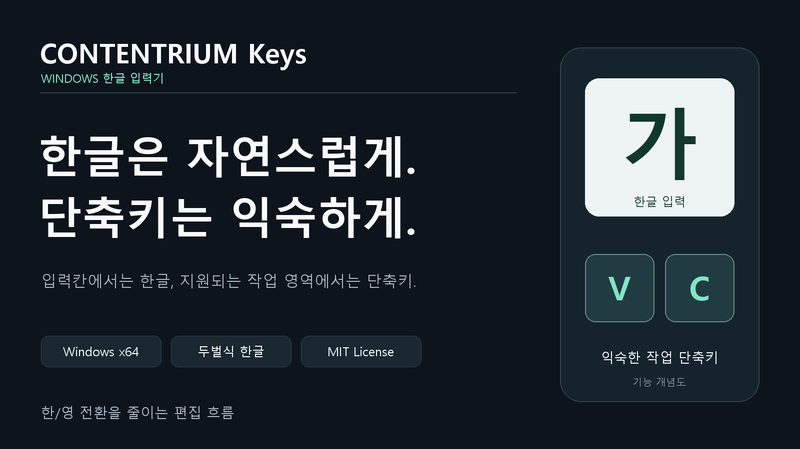
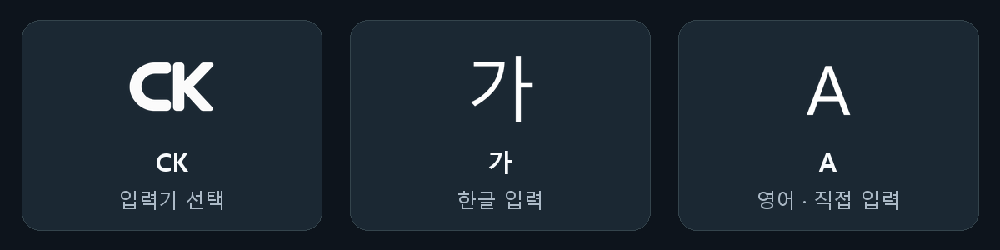

# CONTENTRIUM Keys

입력칸에서는 **한글을 자연스럽게**, 지원되는 작업 영역에서는 **한/영 전환 없이 편집 단축키를** 사용하세요.

**2.0.2 · Windows x64 · 두벌식 한글 · MIT License**

[배포 페이지](https://github.com/contentriumkorea/rium-keys/releases/latest) · [파일 무결성 확인](https://github.com/contentriumkorea/rium-keys/releases/latest/download/SHA256SUMS.txt) · [설치·복구 안내](docs/installation.md)

설치 파일 **약 661KB**. 최신 정식판만 공개하며, 이전 릴리스와 첨부파일은 삭제하지 않고 비공개 초안으로 보관합니다. `Source code.zip`은 설치 파일이나 포터블 앱이 아닙니다.

## 한글과 단축키 사이, 전환을 줄이세요

- **두벌식 한글 입력** — 입력칸에서 한글을 조합합니다.
- **작업 영역의 원래 단축키** — 지원되는 편집 영역에서 한글 상태를 유지하며 단축키를 사용합니다.
- **익숙한 가 / A 표시** — 한글은 `가`, 영어·직접 입력은 `A`, 입력기 선택 목록의 제품 로고는 `CK`입니다.
- **별도 설정 창 없이 사용** — Windows 입력기 메뉴에서 한/영 전환과 입력기 사용 여부를 조절합니다.

*제품 아이콘과 표시의 의미를 정리한 예시입니다. 배경과 배치는 설명용이며 Windows 화면 캡처가 아닙니다.*

## 설치하고 사용하기

1. **한국어 Microsoft 입력기를 준비합니다.** 새 설치 전 현재·기본 입력기로 선택하고, 복구를 위해 삭제하지 마세요.
2. 작업을 저장하고 편집 프로그램을 종료한 뒤 **설치 파일을 일반 실행**합니다. 등록 단계에서 Windows 관리자 확인창의 **예**를 누릅니다.
3. 자동 점검이 끝나면 **마침**을 누릅니다. 직접 타이핑하는 시험은 없으며, 재시작 시점은 선택할 수 있습니다.
4. **Windows + Space → CONTENTRIUM Keys**를 선택합니다. `가 / A`를 클릭해 한/영을 바꾸고, 우클릭 메뉴에서 **입력기 사용**을 조절합니다.

별도 트레이 유틸리티나 자동 실행 EXE를 켜지 않습니다. Windows가 선택된 입력기를 불러오며, 기본 입력기로 유지하면 로그인 후에도 사용할 수 있습니다. Windows가 `CK`와 `가 / A`를 나란히 표시해도 프로그램이 두 개 실행된 것은 아닙니다.

**설치 전 확인:** 2.0.1은 바로 업데이트할 수 있습니다. 2.0.0과 그보다 오래된 입력기는 [기존 버전별 설치 순서](docs/installation.md#기존-버전에서-설치)를 먼저 확인하세요. 재시작을 미루면 실행 중인 앱이나 작업 표시줄에 이전 입력기·아이콘이 남을 수 있습니다. 설치 파일에는 Windows 게시자 코드 서명이 없습니다.

## 지원 범위

모든 프로그램의 호환성을 보장하지 않습니다. 아래는 실제 시험한 경로이며, 프로그램 버전이나 패널이 달라지면 추가 검증이 필요합니다.

| 환경 | 확인한 경로 | 아직 확인하지 못한 범위 |
| --- | --- | --- |
| 표준 Windows 입력칸 / 버튼 | 한글 → 원래 V 단축키 → 한글, 조합·입력 상태 유지 | 자체 제작 입력창 전반 |
| Premiere Pro **26.5.2.5** | 검색·자막·오디오/비디오 타임라인·선택된 그래픽의 시험 경로, 입력칸 복귀 후 한글 조합 | 다른 버전·추가 패널·빠른 연속 입력 전반 |
| Studio One **6.6.4.102451** | 검색 → 작업 영역 C 단축키 → 검색, 앱 전환 후 시험 경로 | 다른 버전·나머지 입력칸 |
| After Effects **26.5.0.89** | 한글 입력 일부·입력 위치 판별 | 실제 단축키·입력칸 복귀 |

Premiere·Studio One의 실기 결과는 같은 입력 처리 코드를 사용하는 개발 빌드 8에서 확인했습니다. 2.0.2의 입력 처리는 2.0.1과 같으며, 이번 배포 안내 정리로 호환성이 확대된 것은 아닙니다. [입력·단축키 검증 기록](docs/input-owner-validation.md)

## 업데이트·제거

**현재 2.0.2는 설치 파일에 본체가 포함된 설치형 배포입니다.** 새 버전은 GitHub에서 설치 파일을 받아 업데이트합니다. 경량 온라인 설치기와 설치 후 자동 업데이트는 현재 공개판에 포함되어 있지 않습니다.

Windows 입력기로 등록해야 동작하므로 **설치 없이 실행하는 포터블 ZIP은 제공하지 않습니다.** 이 저장소의 소스 ZIP을 포터블로 안내하지 않습니다.

- **이미 2.0.2가 설치되어 있으면:** 이번 안내 변경 때문에 다시 설치할 필요는 없습니다.
- **제거:** Windows 설정 → 앱 → 설치된 앱 → **CONTENTRIUM Keys → 제거**. 설치 전 입력기로 복구하며 개인 설정과 복구 기록은 보존합니다.
- **구형 RIUM Keys 유틸리티:** 새 입력기로 자동 전환되지 않습니다. [설치·전환 방법](docs/installation.md)을 따르세요.

## 개인정보

입력 내용과 문서 내용을 서버로 전송하지 않습니다. **2.0.2 입력기 자체는 업데이트 확인 통신도 하지 않습니다.** 설정·복구 기록·설치 로그는 PC에 보관하며, 위치는 [설치·복구 안내](docs/installation.md)에 정리했습니다.

## 라이선스와 출처 표기

**자유롭게 사용하세요. 복제·재배포할 때는 출처와 라이선스 고지를 남겨주세요.** 콘텐츠리움이 작성한 코드와 문서는 [MIT 라이선스](LICENSE)로 제공하며 개인·업무·상업적 사용, 수정과 재배포를 허용합니다. 원본이나 주요 부분을 복제·배포할 때 저작권 표시와 라이선스 원문을 함께 유지하세요.

> 출처 안내 예시: CONTENTRIUM Keys by Contentrium — https://github.com/contentriumkorea/rium-keys

위 한 줄이 라이선스 원문을 대신하지는 않습니다. 설치 폴더의 `LICENSE`, `THIRD_PARTY_NOTICES.md`, `licenses` 폴더를 함께 유지하세요. 프로그램 화면이나 이 입력기로 만든 영상·문서에 출처를 삽입할 의무는 없습니다.

MIT 라이선스 [Jamotong](native-ime/third_party/jamotong/LICENSE) 한글 조합 엔진을 기반으로 합니다. 외부 구성요소에는 각 원저작자의 조건이 적용됩니다. [외부 라이선스·저작권 안내](THIRD_PARTY_NOTICES.md)

검증 기록과 개발 자료

- [2.0.2 검증 기록과 한계](docs/release-2.0.2.md)
- [2.0.1 검증 기록](docs/release-2.0.1.md)
- [프로그램별 입력·단축키 검증](docs/input-owner-validation.md)
- [버전별 내부 지원 범위](native-ime/providers/README.md)
- [개발 및 빌드](native-ime/README.md)
- [예전 1.1.1 유틸리티 설명](docs/legacy-tray-1.1.1.md)

저장소 주소 `rium-keys`는 기존 링크 호환을 위해 유지합니다. macOS 구름 입력기와는 별개의 Windows 프로젝트입니다.

---

